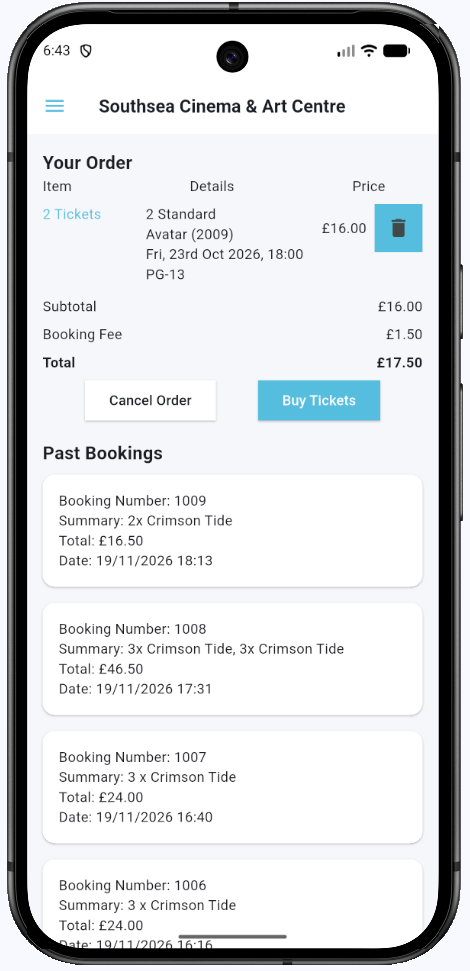

# Southsea Cinema

Southsea Cinema is an Android Flutter app for browsing films and ordering cinema tickets.

## Features

- Browse available films loaded from `assets/data/movies.json`.
- View film details and choose between one and five tickets.
- Add and remove ticket items in the basket.
- Calculate the subtotal, booking fee, and total.
- Checkout atomically: an order and all of its items are saved together.
- View past bookings, including item names, quantities, unit prices, and totals.
- Save address, email, and patron number settings locally.
- Choose whether to receive news by email.
- Switch between light and dark themes.
- Migrate the local SQLite database from schema v1 to v2 without removing existing
  bookings.

### Movie page


### Basket



## Installation

Install Flutter and an Android emulator, then download the project dependencies:

```bash
flutter pub get
```

## Run on an Android emulator

Start an Android emulator, then run:

```bash
flutter run
```

This app supports Android only.

## Run the tests

```bash
flutter test
```
