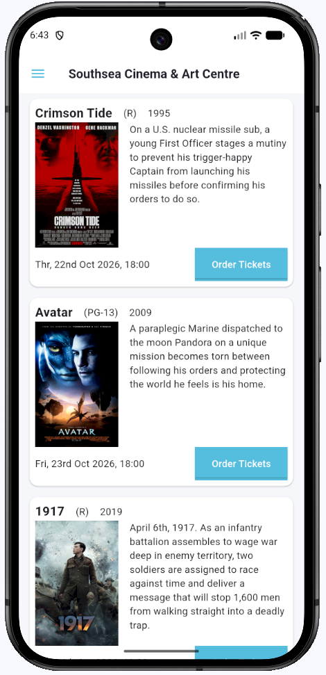

# Southsea Cinema

Southsea Cinema is an Android Flutter app for browsing films and ordering cinema tickets.

## Features

- View available films and their details.
- Choose the number of tickets.
- Add tickets to a basket.
- Remove tickets from the basket.
- Buy tickets and save the order locally.
- View a booking confirmation.
- Save address, email and patron number details.
- Choose whether to receive news by email.
- Switch between light and dark themes.

### Movie page



### Basket


## Installation

Install Flutter and an Android emulator, then download the project dependencies:

```bash
flutter pub get
```

## Run on an Android emulator

Start an Android emulator, then run:

```bash
flutter run
```

This app supports Android only.

## Run the tests

```bash
flutter test
```
